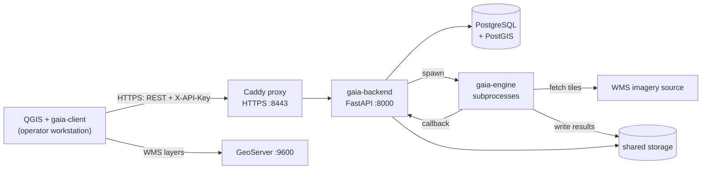

# GAIA — system architecture

Canonical description of how GAIA is put together. `gaia-engine` and
`gaia-client` link here rather than repeating it.

## What GAIA does

GAIA turns aerial imagery into vector map data. An operator selects an area in
QGIS, picks which object types to detect (buildings, roads, vegetation), and
GAIA fetches the imagery, runs semantic segmentation over it, vectorises the
result, and returns a GeoPackage that loads back into QGIS as map layers.

It is designed to be self-hosted by an organisation that owns or licenses its
own imagery — typically a municipality with a WMS service.

## The three repositories

| Repository | Role | Runs as |
|---|---|---|
| **gaia-backend** | Orchestrator. REST API, database, job queue, task scheduling. | Long-lived HTTP service (Docker) |
| **gaia-engine** | The actual processing. Tiling, segmentation, vectorisation, comparison. | Short-lived subprocesses launched by the backend |
| **gaia-client** | User interface. A QGIS plugin. | Inside QGIS on the operator's workstation |

They are separate because they have genuinely different lifecycles. The engine's
modules each need their own Python environment — `torch` for segmentation, GDAL
for imagery, `fiona`/`shapely` for vectors — and those dependency sets conflict.
The backend stays a thin, fast-starting service and shells out to the engine.
The client is bound to whatever Python QGIS ships.



## Processing pipeline

A **project run** is one job. It is decomposed into ordered **tasks**, and each
task into **steps** — the units that actually execute. One step is one engine
subprocess.

| Order | Task type (`alias`) | Handler | What it does |
|---|---|---|---|
| 1 | `TileImagesSrc` | `tile_image` | Fetch imagery from WMS, cut into overlapping tiles |
| 2 | `SegmentProcess` | `segment_process` | Run a segmentation model per tile, per object class |
| 3 | `MergeTiles` | `merge_tiles` | Reassemble per-class raster masks from tiles |
| 4 | `Vectorize` | `vectorize_tile_results` | Convert raster masks to polygons |
| 5 | `MergeGeoPackages` | `merge_geo_packages` | Combine per-class vectors into one GeoPackage |
| 6 | `ApplyConfidence` | `apply_confidence` | Filter features below the confidence threshold |

Aliases map to handler modules in `app/tasks/tasks/__init__.py`
(`get_function_name_from_alias`). Each handler builds the step list for its task
and returns it; the dispatcher runs steps one at a time.

**Scheduling.** `app/tasks/poller.py` polls on an interval. `Dispatcher`
(`app/service/dispatcher.py`) picks the next task by `task_type.order`, calls the
handler to create steps, and marks the task `RUNNING`. Only one step runs at a
time — `is_any_step_running()` gates the loop.

**Failure propagation is all-or-nothing per run.** A task handler that returns
zero steps raises, and the dispatcher marks the whole project run `ERROR`. This
is why an upstream failure surfaces as a confusing message several stages later:
if segmentation produces no finished steps, `Vectorize` reports
`No steps found for Task type Vectorize` rather than naming the real cause.

## How the backend calls the engine

The backend never imports engine code. Each engine module is an **interface**,
declared by a `model.json` at its root, discovered at startup and executed as a
subprocess in its own virtual environment.

```json
[
  {
    "name": "Segmentation - Buildings (ResUNet)",
    "group": "Classification",
    "description": "Building segmentation using ResUNet architecture",
    "args": {
      "classname": "buildings",
      "image_path": "",
      "output_path": "",
      "callback_url": ""
    },
    "function_name": "runInference",
    "module_file_name": "engine_runner.py"
  }
]
```

| Field | Meaning |
|---|---|
| `name` | Unique identifier, stored in the database |
| `group` | `Internal`, `Classification`, `Vectorization`. `Classification` members are what the client offers as selectable object types. |
| `args` | Default arguments, rendered as `--key value` on the command line. Empty strings are filled in per step. |
| `function_name` | Entry point inside the module |
| `module_file_name` | Script the subprocess executes |

**Discovery** (`InterfaceService.scan_and_install_interfaces`) walks
`MODEL_BASE_PATH` two levels deep, so both `segmentation/` and
`core/image_bitter/` are found. A directory containing `model.json` is an
interface and is not descended into further.

**Installation** creates `<interface>/venv` and runs
`pip install -r requirements.txt` — **on every backend start**, not just the
first. This has a sharp edge: if that install fails, the interface is flagged
`installed = False` *and* `is_active = False`, which removes it from
`GET /models/segmentation` and so from the client's object-type selector, with
no error shown to the user. See `docs/OPERATIONS.md`.

**Execution** (`app/tasks/task_runner.py`) builds
`<venv>/bin/python <module_file_name> --arg value ...` and runs it with
`asyncio.create_subprocess_exec`. No timeout is applied at this level. The
engine reports completion by calling back to `/run_result/{step_external_id}`.

## Imagery and tiling parameters

These are the values that determine output quality and runtime. Defaults come
from `core/wms_tiler/model.json`.

| Parameter | Default | Unit | Notes |
|---|---|---|---|
| `tile_size_pixels` | `1024` | px | Square tiles |
| `mpp` | `0.08` | metres/pixel | Ground sampling distance requested from the WMS |
| `overlap` | `10` | percent | Client accepts 0–50 |
| `image_format` | `geotiff` | — | Carries the georeference |
| `epsg` | *required* | — | Projected CRS, e.g. `EPSG:3006` (SWEREF99 TM) |
| `bbox` | *required* | map units | See ordering note below |

**Derived tile geometry** (`core/wms_tiler/usecase/create_tile_boundaries.py`):

```
tile_size_metres     = mpp × tile_size_pixels          # 0.08 × 1024 = 81.92 m
unpadded_tile_metres = tile_size_metres × 100 / (overlap + 100)
overlap_metres       = tile_size_metres × (overlap / 100)
```

Tiles are generated across the bounding box at `unpadded` spacing, then each is
grown by `overlap_metres` on every side. Overlap exists so features crossing a
tile boundary are seen whole by the model; it is trimmed during `MergeTiles`.

**Bounding box ordering is unusual.** `bbox` is
`topLeft_x, topLeft_y, bottomRight_x, bottomRight_y` — that is
**`min_x, max_y, max_x, min_y`**, *not* the `min_x, min_y, max_x, max_y` that
most GIS tools use. The client labels it accordingly
("Valt område (minX, maxY, maxX, minY)"). Getting this wrong yields an empty or
mirrored result rather than an error.

**Model resolution.** Segmentation models declare their own resolution in
`segmentation/parameters.json`:

| Class | Model type | Checkpoint | Resolution |
|---|---|---|---|
| `buildings` | ResUNet | `models/buildings_50e.ckpt` | 0.05 m/px |
| `roads` | ResUNet | `models/roads_50e.ckpt` | 0.05 m/px |

**Resolution is reconciled at inference time, not assumed.** The
checkpoints declare `resolution: 0.05` m/px while the tiler defaults to
`mpp: 0.08`. `ResUNetInferencer` handles this explicitly — it rescales each tile
from its own resolution to the model target and crops to a multiple of 32 pixels
(the FPN decoder requires it), then resizes the prediction back to the input
size. So the two values are not in conflict.

What it does mean is that production tiles are **upsampled** 0.08 -> 0.05, and
upsampling cannot recover detail the imagery never captured. Imagery natively
near 0.05 m/px should be expected to perform better.

**Confidence.** `confidence_level` is validated backend-side as
`0 < value <= 100` and applied in the final `ApplyConfidence` stage. The client
suggests `75`.

**Vectorisation** is tuned per object class (`vectorisation`, see
`config_testcase.json` for the shape). Values are in map units — metres for a
projected CRS:

| Class | `min_area` | `smallest_hole` | `shortest_edge` | `gap_closure` | `simplify` |
|---|---|---|---|---|---|
| buildings | 10 | 4 | 0.5 | 0.5 | `vwp`, tol 0 |
| roads | 5 | 5 | 1 | 4 | `vwp`, tol 1 |
| vegetation | 20 | 5 | 0.5 | — | `vwp` |

Buildings use a dedicated `building` vectoriser that favours straight edges and
right angles; roads and vegetation use the general path with smoothing
(`chaikin` for vegetation).

## Storage

Artefacts live on a shared filesystem, not in the database. The database holds
only metadata and paths. The hierarchy mirrors the run decomposition, and each
level writes its results into an `output/` folder beside its inputs:

```
STORAGE_PATH/
  project-<project_id>/
    run-<run_id>/                     <- ProjectRun.input_path
      output/                         <- final run artefacts
      <task_type_name>/               <- one per task, e.g. TileImagesSrc
        <task_step_id>/               <- one per step (one engine subprocess)
          output/                     <- that step's results
```

A step's output directory is the next step's input. `MergeTiles` reads the
`output/` folders of the finished `SegmentProcess` steps, and `Vectorize` reads
those of `MergeTiles` — which is why a step that "succeeds" but writes no files
stalls the pipeline without raising.

> **Known bug.** `CreateProjectRunUseCase.create_assign_project_paths` assigns
> both `input_path` and `output_path` by calling
> `create_project_run_input_path()`, so a run's `output_path` is set to its
> input path and the dedicated `create_project_run_output_path()` (which appends
> `output/`) is never used. Harmless today because steps derive their own paths,
> but it makes `ProjectRun.output_path` misleading.

Both the backend and the engine subprocesses need this path mounted at the same
location — they exchange data through it. `MODEL_BASE_PATH` similarly points at
the `gaia-engine` checkout, mounted into the backend container.

## Deployment

`docker/linux.docker-compose.yml` defines these containers on a bridge network
(plus a one-shot `geoserver-preflight` check):

| Service | Port | Exposure |
|---|---|---|
| `proxy` | 8443 | All interfaces — HTTPS; QGIS clients connect here |
| `gaia` | 8000 | **Loopback only** — plain HTTP, reached by the proxy by name |
| `geoserver` | 9600 | All interfaces — serves WMS layers to QGIS |
| `db` | 5432 | **Loopback only** — reached over the internal network by name |

The engine is *not* a container. It is a directory bind-mounted into the
backend, whose subprocesses run inside the backend container.

Authentication is a single shared API key (`GAIA_API_KEY`, sent as `X-API-Key`).
There are no user accounts. See [SECURITY.md](../SECURITY.md) before exposing
any of this to a network.

## Constraints worth knowing before changing things

- **The GDAL pip pin and the Docker base image must move together.** The Python
  bindings must match the native `libgdal`. Changing one alone breaks image
  processing at runtime, not build time.
- **Changing the base image invalidates every interface venv.** They are on a
  bind-mount and survive rebuilds, but link against the old interpreter. All of
  them must be deleted. See `gaia-engine/docs/security-fixes-260817.md`.
- **The client cannot upgrade its own dependencies.** It uses the libraries
  inside QGIS. Patching them means upgrading QGIS; the supported baseline is
  **QGIS 3.44 LTR** (Python 3.12). The plugin uses `enum.StrEnum` and PEP 604
  unions, so it cannot load on QGIS 3.28 at all.
- **QGIS 4.x is not supported.** It is Qt6/PyQt6; the plugin imports PyQt5
  throughout. `metadata.txt` sets `qgisMaximumVersion=3.99` to prevent install.
- **Only one step runs at a time.** There is no parallelism within a run and no
  concurrency across runs.
